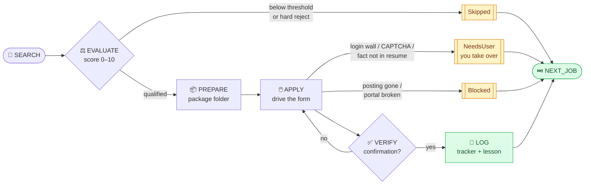
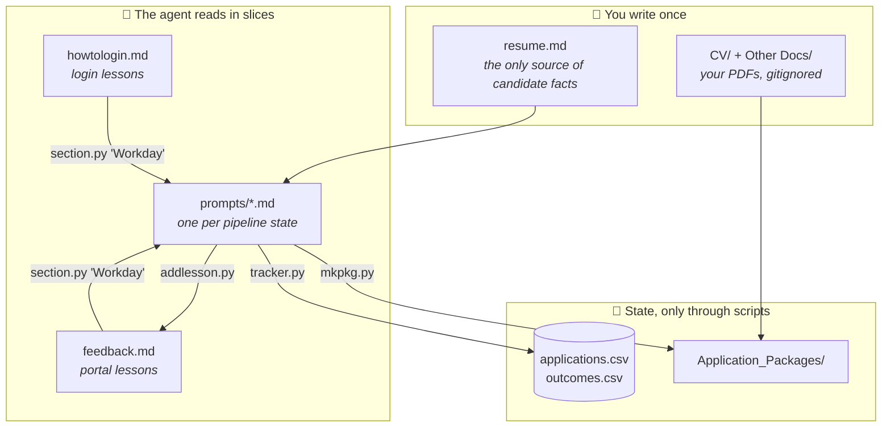
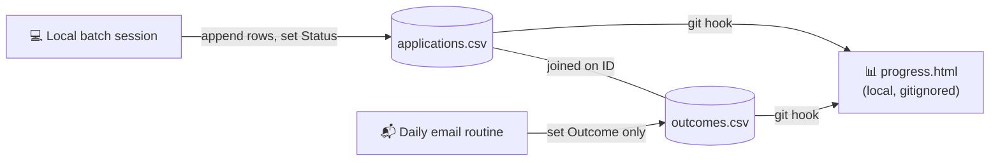
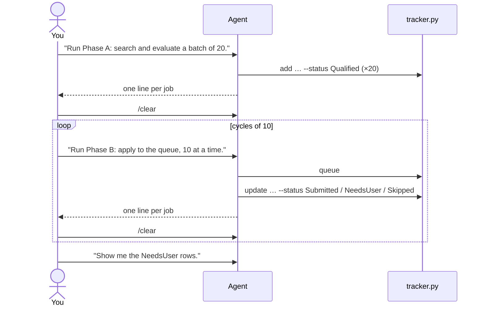
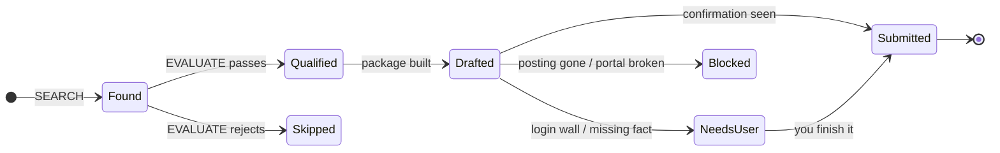

<div align="center">



<p>
  <a href="#quick-start"></a>
  <a href="https://claude.ai/code"></a>
  <a href="LICENSE"></a>
</p>
<p>
  
  
  
  
  
</p>

**Your coding agent finds the jobs, writes the documents, fills the forms and checks your inbox.<br>
You fill in your resume once and take over at login walls.**

[Quick start](#quick-start) ·
[How it works](#how-it-works) ·
[Setup](#setup) ·
[Running a batch](#running-a-batch) ·
[Configuration](#configuration) ·
[FAQ](#faq)

</div>

---

<div align="center">

<br><sub>An illustrative run with fictional companies: the format the agent reports in, one line per job.</sub>
</div>

## ✨ Highlights

<table>
<tr>
<td width="33%" valign="top">

### 🧠 It remembers every portal
`application/feedback.md` holds the selectors, traps and dead ends of **51 portals**: Workday, SuccessFactors, Personio, Greenhouse, Lever, Ashby, StepStone, XING, softgarden, Taleo, iCIMS and more. That file is why the second application on a portal works first time.

</td>
<td width="33%" valign="top">

### 🪙 It's frugal with tokens
One session covers **30+ applications**. Knowledge files are read one section at a time, the tracker never enters the context, discovery runs in plain Python, and pages are read with JavaScript instead of screenshots.

</td>
<td width="33%" valign="top">

### 🛡️ It never fakes anything
It doesn't type passwords, create accounts, use SSO or solve CAPTCHAs. If a fact isn't in your resume, the job is marked `NeedsUser`; the agent never guesses. Portal "application sent" screens aren't trusted either: your inbox decides.

</td>
</tr>
<tr>
<td valign="top">

### 📦 A folder per job
`Application_Packages/<Company>_<Role>/` holds the posting, the CV that was sent, supporting documents, the cover letter and a confirmation screenshot.

</td>
<td valign="top">

### 📊 A tracker you can merge
Two plain CSVs, each with exactly one writer, so a local batch and a daily inbox routine never conflict in git. A local HTML dashboard rebuilds itself after every pull.

</td>
<td valign="top">

### ✍️ You can read the whole thing
The prompts are plain Markdown and they *are* the configuration. Built for Claude Code, but they work with any agent that can run a shell and drive a browser.

</td>
</tr>
</table>

> [!NOTE]
> It was built for the German/EU student market (Werkstudent, Praktikum, Masterarbeit), so the
> language handling and several portals lean German. The pipeline itself works in any market: edit
> `prompts/search.md` and `prompts/evaluator.md` to retarget it.

---

## 📑 Contents

- [Quick start](#quick-start)
- [How it works](#how-it-works)
- [Setup, step by step](#setup)
- [Running a batch](#running-a-batch)
- [The browser layer](#browser-layer)
- [Configuration](#configuration)
- [The knowledge files](#knowledge-files)
- [Supported portals](#supported-portals)
- [Repository layout](#repository-layout)
- [FAQ & troubleshooting](#faq)
- [What is not here](#not-here)

---

<a id="quick-start"></a>

## 🚀 Quick start

```bash
# 1. Get the code and the document dependencies
git clone https://github.com/kelvinvaddoriya/job-application-agent.git
cd job-application-agent
pip install -r requirements.txt          # only needed for the document scripts

# 2. Install the git hooks (once per clone)
python scripts/setup_hooks.py

# 3. Tell the agent which address you apply from (the same one its mail connector reads)
export JOBAGENT_EMAIL="you@example.com"

# 4. Fill in your resume. Everything downstream depends on it.
$EDITOR application/resume.md

# 5. Put your CV(s) in application/CV/primary/   (CV_*.pdf for English, Lebenslauf_*.pdf for German)

# 6. Start your agent in the repo and give it a job
claude
```

Then type, in plain English:

```text
Run Phase A: search and evaluate a batch of 20 jobs.
```

That's enough to try it. Read [Setup, step by step](#setup) before the first real
batch: steps 2 and 3 there matter more than they look.

---

<a id="how-it-works"></a>

## 🔍 How it works

The agent works on **one job at a time, from start to finish**, then moves on to the next. Each
pipeline state has its own prompt file, and `CLAUDE.md` sends the agent from one to the next.



| State | What happens | Prompt |
|---|---|---|
| **SEARCH** | Sweeps LinkedIn's guest API and public ATS boards without a browser, drops jobs already in the tracker, screens out language requirements | `prompts/search.md` |
| **EVALUATE** | Scores 0–10 against your resume, checks the per-company cap, picks the CV language and variant | `prompts/evaluator.md` |
| **PREPARE** | Builds `Application_Packages/<Company>_<Role>/`: posting, CV, supporting docs, cover letter | `prompts/coverletter.md` |
| **APPLY** | Fills the form in the browser, reading the page with JavaScript first and using what it knows about that portal | `prompts/application.md` |
| **VERIFY** | Checks for a confirmation page or confirmation email. Portal "sent" screens can't be trusted on their own | `prompts/application.md` |
| **LOG** | One `tracker.py update` call, and any new lesson filed with `addlesson.py` | — |

### Where everything lives

Each fact lives in **one file only**. That one rule is what keeps the agent's context small enough
for 30+ applications per session.



### Design rules

- **Tokens are the real limit.** Nothing gets read end to end. Knowledge files are read one
  heading at a time (`section.py`), the tracker never enters the context (`tracker.py`), and
  discovery runs in Python so that only the jobs that pass reach the conversation. Pages are read
  with JS, at about 3 screenshots per job.
- **The agent stops at the trust line.** It fills in everything up to a password, a new account,
  an SSO prompt or a CAPTCHA, then hands over to you.
- **Every answer is true.** If a fact is missing, the job is marked `NeedsUser`. The agent never
  guesses.

---

<a id="setup"></a>

## 🛠️ Setup, step by step

> [!TIP]
> Work through this checklist once before your first real batch:
>
> - [ ] Python 3.10+ installed, `pip install -r requirements.txt` done
> - [ ] `python scripts/setup_hooks.py` run in this clone
> - [ ] `JOBAGENT_EMAIL` exported, **and** it's the mailbox your agent can read
> - [ ] `application/resume.md` filled in completely
> - [ ] At least one CV in `application/CV/primary/`
> - [ ] Supporting documents in `Other Docs/`, mapped in `scripts/mkpkg.py` → `DOCS`
> - [ ] `prompts/search.md` keywords set to the roles *you* want
> - [ ] A browser harness that provides the ten primitives (only needed for APPLY, see [The browser layer](#browser-layer))

<details open>
<summary><b>1 · Requirements</b></summary>

| Need | For | Required? |
|---|---|---|
| Python 3.10+ | everything | ✅ always |
| `pip install -r requirements.txt` (`python-docx`, `pypdf`, `Pillow`) | document scripts | ✅ for PREPARE |
| A coding agent with a shell (e.g. [Claude Code](https://claude.ai/code)) | running the pipeline | ✅ always |
| A browser harness with the [ten primitives](#browser-layer) | APPLY | only for applying |
| `pdflatex` (MiKTeX or TeX Live) | per-job tailored CVs | optional |
| Windows + Word | `docx2pdfa.ps1`, the scheduled-task scripts | optional |

Everything else works on any platform. The tracker, discovery and browser helpers use only the
standard library.

</details>

<details open>
<summary><b>2 · Use one email address everywhere</b></summary>

**Use one email address for every job platform, every portal account and every email
application, and make it the mailbox your agent can read.**

```bash
export JOBAGENT_EMAIL="you@example.com"
# only while you are moving old accounts over; unset it once you're done:
export JOBAGENT_EMAIL_FALLBACK="old@example.com"
```

> [!IMPORTANT]
> VERIFY treats your inbox as the final word on whether an application went out. An account
> registered under a second address still submits fine, but its confirmations land in a mailbox
> the agent can't read. The application then looks unsent, you apply again, and the employer gets
> it twice.

This is also hard to undo later. StepStone's smart-apply locks the email field to your profile
address, so you can't change it per application.

- If you use the optional [daily email check](#setup) (step 6), it reads
  *that* mailbox. A confirmation that lands anywhere else never reaches the tracker.
- `creds.py check` compares every saved portal username with `JOBAGENT_EMAIL` and flags any other
  address as UNKNOWN. That's how you find accounts registered under an old address before they
  cause a duplicate application.

</details>

<details open>
<summary><b>3 · Fill in your resume</b></summary>

```bash
cp application/resume.md application/resume.md.bak   # keep the template around
$EDITOR application/resume.md
```

People skip this step and then wonder why their applications sound generic. **Every claim in every
cover letter comes from a line in this file**, and a form question this file can't answer stops
the job with `NeedsUser` instead of getting a made-up answer.

</details>

<details>
<summary><b>4 · Add your documents</b></summary>

| Folder | Put here |
|---|---|
| `application/CV/primary/` | Your designed CV, one per language. English must start with `CV_`, German with `Lebenslauf_` |
| `application/CV/secondary/` | Optional second variant for a different kind of role. Say which is which in `prompts/evaluator.md` |
| `Other Docs/` | Transcript, enrollment certificate, references. Map the filenames in the `DOCS` dict at the top of `scripts/mkpkg.py` |

All three folders are gitignored. **Keep them that way.** The repo is meant to be public; your
paperwork isn't.

**Optional: per-job tailored CVs.** Copy the template and fill it in from `resume.md` once, in both
languages:

```bash
cp application/cv_data.example.py application/cv_data.py
# try the shipped fictional example first:
PYTHONUTF8=1 python scripts/make_tailored_cv.py --data application/cv_data.example.py --job example_ml_thesis --compile
```

After that, the agent adds one small `JOBS` entry per tailored job, which chooses and orders that
content. It never invents any. Most applications should still go out with your designed CV; a
tailored one is only worth it when the portal accepts a separate CV for each application.

</details>

<details>
<summary><b>5 · Install the git hooks</b></summary>

```bash
python scripts/setup_hooks.py
```

This installs post-merge/post-commit hooks that rebuild the local `progress.html` dashboard. Hooks
live in `.git/`, which isn't cloned, so run this **once per clone**. The two tracker CSVs ship with
only their header row; `tracker.py add` fills them in.

</details>

<details>
<summary><b>6 · Optional: the daily email check</b></summary>

`outcomes.csv` is meant to be written by a separate scheduled agent. It reads your inbox for
replies, classifies each one (Offer › Interview › Rejection › Update › Acknowledged), and pushes
only that file.



Each file has a single writer, so git merges them as ordinary text and needs no merge driver. The
prompt ships as `prompts/routine_email_check.md`. You set up the scheduler and mailbox access
yourself; any scheduled agent with a mail connector, a shell and push access to your remote will
do. It must read `application/applications.csv`, write **only** `application/outcomes.csv` through
`tracker.py update --outcome`, never create rows, and never force-push.

</details>

---

<a id="running-a-batch"></a>

## ▶️ Running a batch

Start your agent in the repo. It reads `CLAUDE.md`, which takes it through the prompts. For anything
bigger than a handful of jobs, run it in **two phases** and clear the context in between:



| Phase | What to say | What happens | Cost |
|---|---|---|---|
| **A** | *"Run Phase A: search and evaluate a batch of 20."* | SEARCH + EVALUATE everything and fill the tracker with `Qualified` rows | Cheap. Can be handed to a smaller model's subagent |
| **B** | *"Run Phase B: apply to the queue, 10 at a time."* | PREPARE → APPLY → VERIFY → LOG for each job in `tracker.py queue` | The expensive part |

All state is kept in the tracker and the package folders, so **`/clear` between cycles is always
safe**. Nothing is lost.

<details>
<summary><b>Useful things to say mid-batch</b></summary>

| Say | Runs |
|---|---|
| "What's in the queue?" | `python scripts/tracker.py queue` |
| "How are we doing?" | `python scripts/tracker.py stats` |
| "Have I applied to Acme before?" | `python scripts/tracker.py check "Acme"` (duplicate + 90-day company cap) |
| "Did my email applications go out?" | `python scripts/tracker.py emails` |
| "What do we know about Workday?" | `python scripts/section.py application/feedback.md "Workday"` |
| "Do I have a saved login for this portal?" | `python scripts/creds.py check <job-url>` |

</details>

### What each status means



| Status | Meaning | Your move |
|---|---|---|
| `Found` / `Qualified` | Waiting in the queue | Nothing, Phase B picks it up |
| `Drafted` | Package built or form filled, but no confirmation seen | Check the portal or your inbox |
| `Submitted` | Confirmation seen (page or email) | Wait for the outcome |
| `NeedsUser` | Agent stopped at the trust line, reason in Notes | Log in / answer / finish it yourself |
| `Skipped` | Didn't qualify, reason in Notes | Nothing |
| `Blocked` | Posting gone or portal broken | Nothing |

Outcomes come from the employer's replies and go in a separate column: `Awaiting`, `In Progress`,
`Interview`, `Offer`, `Rejected`, `Ghosted`.

---

<a id="browser-layer"></a>

## 🌐 The browser layer

> [!WARNING]
> **This is the one real dependency, and it doesn't ship with the repo.** SEARCH and EVALUATE work
> without a browser. APPLY needs one.

`bh_helpers.py`, `xing_apply.py` and `tests/bh_selftest.py` are written for a harness that runs
Python with these ten names already defined, talking to a real Chrome over CDP:

```
js(expr) -> value          cdp(method, **params) -> dict     press_key(key)
fill_input(css, text)      click(css)                        goto_url(url)
new_tab()                  switch_tab(n)                     list_tabs()
upload_file(css, path)     screenshot(...)
```

`js` and `cdp` handle about 90% of the calls; the other eight are thin. The project was built with a
local CLI called `browser-harness`, invoked as `browser-harness <<'PY' ... PY`. **If you don't have
it, write those ten functions on top of whatever you do have** (Playwright, Puppeteer or raw CDP),
and everything built on them works unchanged.

Check your implementation with the self-test, which checks ~60 behaviours against a local fixture:

```bash
browser-harness < tests/bh_selftest.py     # opens tests/fixtures/form.html
```

<details>
<summary><b>Why the helpers exist instead of raw CDP calls</b></summary>

`feedback.md` § 6 lists the ways real ATS forms break naive automation: a background tab makes
Chrome refuse every `Input.*` call, a native value-setter appends text instead of replacing it, a
consent overlay quietly swallows a click, and shadow-DOM labels can't be reached by any CSS
selector. `keep_rendering()`, `safe_click()`, `safe_fill()` and `form_snapshot()` are those lessons
written as code. Writing the ten primitives takes an afternoon. Relearning the lessons takes far
longer.

</details>

---

<a id="configuration"></a>

## ⚙️ Configuration

There's deliberately very little. **The prompts are the configuration**, and you're meant to edit
them.

| Where | What you change |
|---|---|
| `prompts/search.md` | Keywords, role terms, target market, hard rejects |
| `prompts/evaluator.md` | The 0–10 scoring weights, the apply threshold, the per-company cap |
| `scripts/li_jobs.py` → `DEFAULT_KW`, `BAD_TITLE`, `TECH` | The keyword and filter regexes for discovery |
| `scripts/mkpkg.py` → `DOCS` | Your supporting-document filenames |
| `prompts/coverletter.md` | Letter structure, length, banned openers |
| `application/cv_data.py` | Everything the CV generators print |
| `JOBAGENT_EMAIL` | The one address you apply from. `creds.py` checks saved logins against it; `tracker.py emails` uses it to tell your address apart from a recipient's |
| `JOBAGENT_EMAIL_FALLBACK` | An older address you still have portal accounts under. Unset it once you've moved them |
| `JOBAGENT_LETTER_DE` / `_EN` | Path to your .docx letterhead per language, used by `make_cover_letter.py` |

---

<a id="knowledge-files"></a>

## 📚 The knowledge files

`feedback.md` (portal lessons) and `howtologin.md` (login lessons) are the project's memory. They
only stay useful if they can be read one section at a time, so both follow the same layout:

```
## <Portal>
### <Portal> — General      ← applies to every employer on that ATS
### <Portal> — <Company>    ← applies to one employer
```

**Read** one section, never the whole file:

```bash
python scripts/section.py application/feedback.md "General"          # once per batch
python scripts/section.py application/feedback.md "Workday"          # one portal
python scripts/section.py application/feedback.md "Workday — Airbus" # one employer
python scripts/section.py application/feedback.md --list             # every heading
```

**Write** with the script, so each lesson ends up in the right place:

```bash
python scripts/addlesson.py feedback "Personio" "General" "Guest apply needs no account; ..."
python scripts/addlesson.py login    "Workday"  "Siemens" "Tenant has a real account wall; ..."
```

The copy in this repo has the **general** knowledge: cross-portal rules plus each ATS's
`— General` section. The company-specific sections from the private repo it came from were removed.
Yours will build up as you use it.

<details>
<summary><b>A few hard-won rules from the file</b></summary>

- Portal "application sent" screens lie. Check your inbox after every batch.
- `Input.insertText` appends to the existing value instead of replacing it.
- A submit button that stays disabled is almost always `document.hidden === true`, not a missing field.
- Ashby's date fields are MM/DD/YYYY, so `01.09.2026` silently becomes 9 January.
- Uploading three files back to back silently drops two. Upload one at a time and confirm each by
  its filename in the page text.

Each of these cost a failed application.

</details>

---

<a id="supported-portals"></a>

## 🗺️ Supported portals

There is a playbook section in `application/feedback.md` for each of these:

<table>
<tr>
<td valign="top">

**Enterprise ATS**
- Workday
- SuccessFactors
- Oracle Recruiting Cloud
- Taleo
- iCIMS
- Cornerstone (csod)
- Eightfold
- Phenom
- amazon.jobs

</td>
<td valign="top">

**Startup / mid-size ATS**
- Greenhouse
- Lever
- Ashby
- Personio
- SmartRecruiters
- Recruitee
- Teamtailor
- BambooHR
- Breezy HR
- HiBob
- Factorial
- Jobvite
- JOIN
- Kenjo

</td>
<td valign="top">

**DACH-region ATS**
- softgarden
- d.vinci
- concludis
- umantis
- onlyfy / Prescreen
- Rexx
- HR4YOU
- HRlab
- HRworks
- P&I LOGA
- perbility
- perview
- easyhr
- Empfehlungsbund (EBMS)

</td>
<td valign="top">

**Job boards & other**
- LinkedIn
- XING
- StepStone
- Indeed
- Glassdoor
- arbeitnow
- CHECK24
- catch-talents
- finest-jobs
- Aggregators
- Own-site forms
- WordPress forms
- Notion Forms
- PowerApps portals

</td>
</tr>
</table>

---

<a id="repository-layout"></a>

## 📂 Repository layout

<details>
<summary><b>Folder tree</b></summary>

```
job-application-agent/
├── CLAUDE.md                  # agent contract: pipeline, where knowledge lives, token rules
├── prompts/                   # one file per pipeline state: the actual procedures
│   ├── search.md
│   ├── evaluator.md
│   ├── coverletter.md
│   ├── application.md
│   └── routine_email_check.md # prompt for the optional daily inbox check (not a pipeline state)
├── application/
│   ├── resume.md              # TEMPLATE: fill this in first. Only source of candidate facts
│   ├── feedback.md            # portal knowledge base (not login). Read by section, never whole
│   ├── howtologin.md          # login walls, sessions, autofill. Read by section, never whole
│   ├── applications.csv       # tracker: what you applied to (written by batch sessions)
│   ├── outcomes.csv           # tracker: what came back (written by the email routine)
│   ├── accounts.md            # generated by creds.py: portals you have an account on (gitignored)
│   ├── cv_data.example.py     # TEMPLATE for the CV generators' content
│   ├── cv_data.py             # your copy of it (gitignored)
│   └── CV/
│       ├── primary/           # your designed CVs, EN + DE (contents gitignored)
│       └── secondary/         # a second variant for a different kind of role
├── Other Docs/                # transcripts, certificates, references (gitignored)
├── Application_Packages/      # one folder per job, built by mkpkg.py (gitignored)
├── docs/assets/               # README images
├── scripts/                   # every script the prompts call: see scripts/README.md
└── tests/
    ├── bh_selftest.py         # 60+ checks for the browser helpers, against a local fixture
    ├── test_strip_marks.py    # the invisible-character stripper the document builders share
    └── test_cv_build.py       # the CV / letter generators, against cv_data.example.py
```

</details>

<details>
<summary><b>Scripts</b> (full usage is in each script's docstring and in <code>scripts/README.md</code>)</summary>

| Stage | Script | Used for |
|---|---|---|
| Tracker | `tracker.py` | The only way to read or write the tracker: `check`, `add`, `update`, `queue`, `stats`, `emails` |
| Tracker | `build_dashboard.py` | Rebuilds `progress.html` from the tracker CSVs |
| Tracker | `setup_hooks.py` | Run once per clone: git hooks that rebuild the dashboard |
| Tracker | `daily_pull.ps1`, `setup_daily_pull_task.ps1` | Windows scheduled task for the morning tracker pull |
| Search | `li_jobs.py` | LinkedIn guest-API sweep: `search` → `filter` (tracker dedupe) → `screen` (language gate) |
| Search | `ats_probe.py` | Public ATS APIs: find which ATS hosts a company, read a posting without a browser |
| Prepare | `mkpkg.py` | Builds an `Application_Packages/<Company_Role>/` folder |
| Prepare | `make_cover_letter.py` | Fills a .docx cover-letter template, removing any zero-width characters |
| Prepare | `docx2pdfa.ps1` | .docx → PDF/A through Word COM (the format portals accept) |
| Prepare | `make_tailored_cv.py` | Per-job tailored CV in LaTeX, built from `cv_data.py` and never adding facts |
| Prepare | `make_cover_letter_tex.py` | LaTeX cover letter in the same design |
| Prepare | `make_combined_cv.py` | CV as .docx (EN/DE), for when LaTeX isn't installed |
| Apply | `bh_helpers.py` | Browser form helpers: `keep_rendering`, `form_snapshot`, `safe_click/fill/select`, uploads, shadow DOM |
| Apply | `creds.py` | At a login wall: is there a saved password for this portal, and what does that prove? |
| Apply | `jstr.py` | Encodes non-ASCII text into a JS expression that survives the harness |
| Apply | `xing_apply.py` | Drives a XING "Easy apply" wizard end to end |
| Knowledge | `section.py` | Prints one `##`/`###` section of a knowledge file |
| Knowledge | `addlesson.py` | Files a dated lesson under the right portal/company heading |

</details>

<details>
<summary><b>Tests</b></summary>

```bash
PYTHONUTF8=1 python tests/test_strip_marks.py    # invisible-character stripper
PYTHONUTF8=1 python tests/test_cv_build.py       # CV / letter generators
browser-harness < tests/bh_selftest.py           # browser helpers (needs a harness)
```

</details>

---

<a id="faq"></a>

## ❓ FAQ & troubleshooting

<details>
<summary><b>The agent marked a job <code>NeedsUser</code>. What now?</b></summary>

The reason is in the tracker's Notes column. Ask the agent "show me the NeedsUser rows and why". Usually it's a login wall, a CAPTCHA,
or a form question your `resume.md` can't answer. Finish that one yourself, or add the missing fact
to `resume.md` and let the next batch retry it.

</details>

<details>
<summary><b>It says it hit a login wall. Do I have an account there?</b></summary>

Ask it to run `python scripts/creds.py check <job-url>`. It reads Chrome's saved-password stores
(origins and usernames only, never the password itself) and says how much a match proves:
**strong** on hosts specific to one employer (Workday, Taleo, csod, softgarden, umantis), **weak**
on shared hosts like SuccessFactors. `python scripts/creds.py accounts` regenerates the full list
in `application/accounts.md`.

</details>

<details>
<summary><b>An application shows as Submitted but I never got a confirmation.</b></summary>

Check that the portal account uses `JOBAGENT_EMAIL`. Confirmations sent to any other address are
invisible to the agent ([step 2](#setup)). `creds.py check` flags those accounts as
UNKNOWN identity.

</details>

<details>
<summary><b>I emailed an application and a later batch sent it again.</b></summary>

Email applications have to be logged as `--status Submitted --outcome Awaiting --portal
"email:<recipient>"` the moment the draft is handed to you, never as `NeedsUser`. Run
`python scripts/tracker.py emails` at the end of every batch to catch any drafts that were never
actually sent.

</details>

<details>
<summary><b>The dashboard looks out of date.</b></summary>

```bash
python scripts/build_dashboard.py --if-stale
```

It does nothing if the dashboard is already up to date. If the hooks never run, you skipped
`python scripts/setup_hooks.py` in this clone.

</details>

<details>
<summary><b>I'm not in Germany / not a student.</b></summary>

Edit `prompts/search.md` (keywords, role terms, hard rejects), `prompts/evaluator.md` (scoring and
threshold) and `DEFAULT_KW` / `BAD_TITLE` / `TECH` in `scripts/li_jobs.py`. The portal knowledge
and the pipeline don't depend on the market.

</details>

<details>
<summary><b>Can I use a different agent than Claude Code?</b></summary>

Yes. The prompts are plain Markdown and the scripts are ordinary CLIs. Your agent needs a shell, a
browser harness with the [ten primitives](#browser-layer), and a way to clear its context
between cycles.

</details>

<details>
<summary><b>Git merge conflicts in the tracker CSVs?</b></summary>

Don't reformat, re-sort or re-quote them by hand. They're pinned to LF, one physical line per
record (`.gitattributes`), so a change stays one line. Always `git pull` before a batch, and only
touch them through `tracker.py`.

</details>

---

<a id="not-here"></a>

## 🚫 What is not here

- **Your CV content.** The generators ship without any content. Yours goes in
  `application/cv_data.py`, which you write and git ignores. `cv_data.example.py` shows the
  format with a fictional candidate.
- **A scheduler or mailbox for the email-check routine.** The prompt is included; the account it
  runs under isn't.
- **Credentials of any kind.** `creds.py` reads Chrome's password stores for *origins and usernames
  only*. It never reads, decrypts or prints a password, and the agent never types one.

## 📄 License

MIT. See [`LICENSE`](LICENSE).

<div align="center">
<sub>If this saved you a few hundred form fields, a ⭐ helps other job-seekers find it.</sub>
</div>
