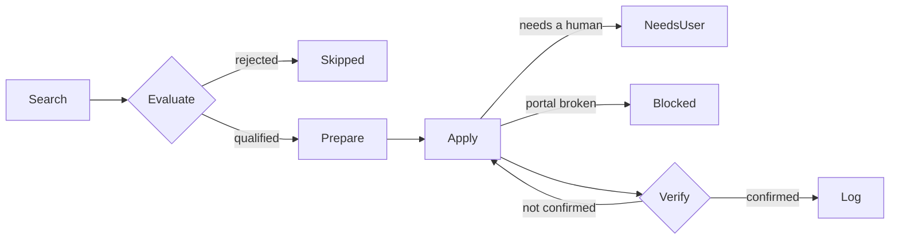

# Job Application Agent

[](https://github.com/kelvinvaddoriya/job-application-agent/actions/workflows/tests.yml)
[](LICENSE)

Job Application Agent is a set of prompts, scripts and portal knowledge that lets a coding agent
run job applications from start to finish. It finds postings, screens them against your resume,
prepares the documents, fills in the application form, confirms the submission and records the
result. It works on one job at a time and stops whenever it needs a human.

It was built for [Claude Code](https://claude.com/claude-code). The prompts are plain Markdown and
the scripts are ordinary command-line tools, so any agent that can run a shell and drive a browser
can use it.

<p align="center">
  
  <br>
  <sub>Example output. Company names are fictional.</sub>
</p>

## Get started

1. Clone the repository and install the document dependencies:

   ```bash
   git clone https://github.com/kelvinvaddoriya/job-application-agent.git
   cd job-application-agent
   pip install -r requirements.txt
   python scripts/setup_hooks.py
   ```

2. Set the one email address you apply from. It must be the mailbox your agent can read:

   ```bash
   export JOBAGENT_EMAIL="you@example.com"
   ```

3. Fill in `application/resume.md`. This is the only place the agent gets facts about you.

4. Put your CV in `application/CV/primary/` (`CV_*.pdf` for English, `Lebenslauf_*.pdf` for German)
   and your supporting documents in `Other Docs/`.

5. Start your agent in the repository and ask it to begin:

   ```text
   > Run Phase A: search and evaluate a batch of 20 jobs.
   ```

The rest of this README explains each step in more detail. Read
[Limitations](#limitations) and [Responsible use](#responsible-use) before the first real batch.

## How it works

The agent runs one pipeline per job. Each state has a prompt in `prompts/`, and `CLAUDE.md` moves
the agent from one state to the next.



| State | What happens | Prompt |
|---|---|---|
| Search | Collects postings from LinkedIn's guest API and public ATS boards without a browser, drops ones already in the tracker, and screens out language requirements | `prompts/search.md` |
| Evaluate | Scores each posting 0–10 against your resume and applies the per-company cap | `prompts/evaluator.md` |
| Prepare | Builds `Application_Packages/<Company>_<Role>/` with the posting, CV, documents and cover letter | `prompts/coverletter.md` |
| Apply | Fills in the form in a real browser, using what is known about that portal | `prompts/application.md` |
| Verify | Looks for a confirmation page or confirmation email | `prompts/application.md` |
| Log | Writes the result to the tracker and files any new portal lesson | — |

Three rules shape the design:

- **Context is the scarce resource.** One session needs to cover 30+ applications, so no file is
  read in full. Knowledge files are read one section at a time, the tracker is only reached through
  `tracker.py`, and pages are read with JavaScript rather than screenshots.
- **The agent stops at trust boundaries.** It does not enter passwords, create accounts, sign in
  with SSO or solve CAPTCHAs. It fills in everything up to that point and hands the job to you.
- **Every answer must be true.** If a form asks for something your resume does not contain, the job
  is marked `NeedsUser`. The agent never guesses.

## Running a batch

Large batches run in two phases. Clear the context between them.

| Phase | Ask | Result |
|---|---|---|
| A | `Run Phase A: search and evaluate a batch of 20 jobs.` | `Qualified` rows in the tracker. This phase is cheap and can be given to a smaller model. |
| B | `Run Phase B: apply to the queue, 10 at a time.` | Each queued job is prepared, submitted, verified and logged. |

Run `/clear` after Phase A and after each cycle of Phase B. All state is in the tracker and the
package folders, so clearing the context loses nothing.

The agent reports one line per job (`Company — Role — Status`). The statuses are:

| Status | Meaning |
|---|---|
| `Qualified` | Waiting for Phase B |
| `Drafted` | Prepared, but no confirmation seen. Check it yourself. |
| `Submitted` | A confirmation page or email was seen |
| `NeedsUser` | Stopped at a login, CAPTCHA or missing fact. The reason is in the Notes column. |
| `Skipped` | Did not meet the criteria |
| `Blocked` | The posting is gone or the portal is broken |

Commands you or the agent can run at any point:

```bash
python scripts/tracker.py queue                 # jobs waiting to be applied to
python scripts/tracker.py stats                 # counts by status
python scripts/tracker.py check "Company"       # duplicate and company-cap check
python scripts/tracker.py emails                # did email applications actually go out?
```

## Requirements

- Python 3.10 or later. The tracker, discovery and browser helpers use only the standard library.
- `pip install -r requirements.txt` for the document scripts (`python-docx`, `pypdf`, `Pillow`).
- A coding agent with shell access.
- A browser harness, for the Apply state only (see below).
- Optional: `pdflatex` for per-job tailored CVs, and Windows with Word for `docx2pdfa.ps1` and the
  scheduled-task scripts.

### Browser harness

The browser layer is not included. `scripts/bh_helpers.py`, `scripts/xing_apply.py` and
`tests/bh_selftest.py` expect a harness that runs Python with these functions already defined,
connected to Chrome over CDP:

```
js(expr)            cdp(method, **params)     press_key(key)
fill_input(css, t)  click(css)                goto_url(url)
new_tab()           switch_tab(n)             list_tabs()
upload_file(css, path)                        screenshot(...)
```

The project was developed with a local CLI called `browser-harness`. If you do not have it, you can
write these functions on top of Playwright, Puppeteer or raw CDP. `js` and `cdp` handle about 90% of
calls. Check your implementation against the self-test:

```bash
browser-harness < tests/bh_selftest.py
```

## Email address

Use one address for every job board, every portal account and every email application, and make
it the mailbox your agent can read.

Verify treats your inbox as the final record of whether an application was sent, because portal
"application sent" screens are not reliable. A confirmation sent to any other address is invisible
to the agent, so the application looks unsent and may be submitted twice. `creds.py check` flags
saved portal logins that use a different address.

## Configuration

The prompts are the configuration. These are the places you are most likely to change:

| File or variable | Controls |
|---|---|
| `prompts/search.md` | Keywords, role types, target market, automatic rejects |
| `prompts/evaluator.md` | Scoring weights, the apply threshold, the per-company cap |
| `prompts/coverletter.md` | Cover letter structure and length |
| `scripts/li_jobs.py` (`DEFAULT_KW`, `BAD_TITLE`, `TECH`) | Discovery keywords and filters |
| `scripts/mkpkg.py` (`DOCS`) | Your supporting document filenames |
| `application/cv_data.py` | Content for the optional CV generators (copy `cv_data.example.py`) |
| `JOBAGENT_EMAIL` | The address you apply from |
| `JOBAGENT_EMAIL_FALLBACK` | An older address you still have accounts under, while you move them |
| `JOBAGENT_LETTER_DE`, `JOBAGENT_LETTER_EN` | Path to your .docx letterhead for each language |

### Daily email check (optional)

`prompts/routine_email_check.md` is a prompt for a scheduled agent that reads your inbox, classifies
employer replies, and records them in `application/outcomes.csv`. Local batches write only
`applications.csv` and the routine writes only `outcomes.csv`, so the two never conflict in git.
You provide the scheduler and the mail access.

## Portal knowledge

`application/feedback.md` contains lessons for 51 job portals and applicant tracking systems,
including Workday, SuccessFactors, Greenhouse, Lever, Ashby, Personio, SmartRecruiters, StepStone,
XING, softgarden, Taleo and iCIMS. `application/howtologin.md` covers login walls and sessions. Both
use the same layout:

```
## <Portal>
### <Portal> — General      applies to every employer on the portal
### <Portal> — <Company>    applies to one employer
```

Read one section with `section.py` and add lessons with `addlesson.py`:

```bash
python scripts/section.py application/feedback.md "Workday"
python scripts/section.py application/feedback.md --list
python scripts/addlesson.py feedback "Personio" "General" "Guest apply needs no account; ..."
```

The published files contain only general, portal-wide lessons. Company-specific sections from the
original private repository were removed.

## Limitations

- **The browser harness is not included.** Search and Evaluate work without it. Apply does not.
- **The defaults target German and EU student roles** (Werkstudent, Praktikum, Masterarbeit). Other
  markets work after you edit the search and evaluation prompts, but they have not been tested as much.
- **Portals change.** A lesson in `feedback.md` can go out of date without warning. When a form
  keeps failing validation, the agent retries a few times and then marks the job `Blocked` instead
  of spending the batch on it.
- **The agent can make mistakes on a form.** Verify catches failed submissions, not wrong answers.
  Check the package folder and the confirmation for early batches, and spot-check after that.
- **Tracker data stays on your machine.** The dashboard is built locally and is not committed.

## Responsible use

This tool submits applications in your name, and you are responsible for what it sends.

- Only apply for roles you would accept. Volume is not the goal; the evaluator's threshold and
  per-company cap exist to prevent spam.
- Every statement in an application must be true. The agent only uses facts from `resume.md`; keep
  that file accurate.
- Follow the terms of the sites you use. Discovery uses public endpoints at a modest rate. Do not
  remove the delays or change it to scrape at scale.
- The agent is designed to stop at passwords, account creation, SSO and CAPTCHAs. Do not change it
  to get around them.

## Privacy and security

- Your resume, CVs, documents, packages, CV data and generated account list are gitignored. Keep
  them that way if you fork this repository publicly.
- `scripts/creds.py` reads Chrome's saved-password database for origins and usernames only. It
  never reads, decrypts or prints a password.
- Application content goes only to the portals you apply to and to your agent's model provider.

To report a security issue, see [SECURITY.md](SECURITY.md).

## Repository layout

```
CLAUDE.md                 Instructions the agent follows: pipeline, file ownership, context rules
prompts/                  One procedure per pipeline state
application/
  resume.md               Template: your facts (fill this in first)
  feedback.md             Portal lessons
  howtologin.md           Login lessons
  applications.csv        Tracker: applications (written by batches)
  outcomes.csv            Tracker: employer replies (written by the email routine)
  cv_data.example.py      Template for the CV generators
  CV/                     Your CVs (gitignored)
Other Docs/               Supporting documents (gitignored)
Application_Packages/     One folder per job (gitignored)
scripts/                  Command-line tools. See scripts/README.md
tests/                    Tests for the document builders and browser helpers
```

## Development

```bash
PYTHONUTF8=1 python tests/test_strip_marks.py
PYTHONUTF8=1 python tests/test_cv_build.py
browser-harness < tests/bh_selftest.py     # requires a browser harness
```

The first two run in CI on every push and pull request. See [CONTRIBUTING.md](CONTRIBUTING.md) for
how to submit portal lessons and code changes.

## License

[MIT](LICENSE)
